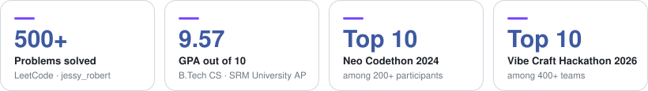

  

  

  &nbsp;
  &nbsp;
  

 

  I build full-stack products and the backend systems behind them: 
  REST APIs, Redis caching, rate limiting, real-time features, and the Docker + CI pipelines that ship them.

  <picture>
    <source media="(prefers-color-scheme: dark)" srcset="https://raw.githubusercontent.com/Robert2101/Robert2101/main/assets/highlights-dark.svg" />
    
  </picture>

 

<h3 align="center">Stack</h3>

<table align="center">
  <tr>
    <td align="right"><b>Languages</b></td>
    <td></td>
  </tr>
  <tr>
    <td align="right"><b>Frontend</b></td>
    <td></td>
  </tr>
  <tr>
    <td align="right"><b>Backend &amp; Data</b></td>
    <td></td>
  </tr>
  <tr>
    <td align="right"><b>DevOps &amp; Tools</b></td>
    <td></td>
  </tr>
</table>

 

<h3 align="center">Projects</h3>

<table align="center">
  <tr>
    <td align="center" width="50%" valign="top">
       
      <a href="https://github.com/Robert2101/TeamPulse"><b>TeamPulse</b></a>
        
      Real-time, multi-tenant project management platform with four-tier RBAC, live boards and Redis caching
        
      
        
    </td>
    <td align="center" width="50%" valign="top">
       
      <a href="https://github.com/Robert2101/LinkForge"><b>LinkForge</b></a>
        
      URL shortener that serves redirects from Redis, rate-limits atomically and batches click analytics
        
      
        
    </td>
  </tr>
  <tr>
    <td align="center" width="50%" valign="top">
       
      <a href="https://github.com/Robert2101/PaySentinel"><b>PaySentinel</b></a>
        
      Fraud detection on 6.3M+ PaySim transactions XGBoost at 96.2% precision, 81.7% recall
        
      
        
    </td>
    <td align="center" width="50%" valign="top">
       
      <a href="https://github.com/ArduPilot/WebTools/pull/287"><b>ArduPilot WebTools</b></a>
        
      Open-source contribution: documentation tooltips for the PID Review tool (PR #287)
        
      
        
    </td>
  </tr>
</table>

 

<h3 align="center">Activity</h3>

  

  

<!-- Generated by .github/workflows/snake.yml into the `output` branch -->

  <picture>
    <source media="(prefers-color-scheme: dark)" srcset="https://raw.githubusercontent.com/Robert2101/Robert2101/output/github-snake-dark.svg" />
    
  </picture>

 

<h3 align="center">LeetCode</h3>

  

  

